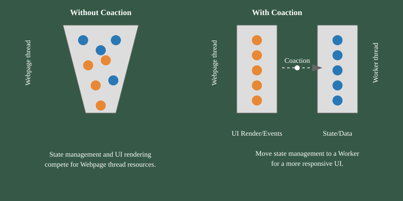

<div align="center">

<a href="https://github.com/coactionjs/coaction" target="_blank"></a>

# Coaction

**Immutable state. Signal-level reactivity. Transactional updates.**

Coaction is an immutable reactive state runtime for TypeScript. Keep React-style immutable snapshots, get signal-level fine-grained reactivity, cache derived state automatically, and use the same transition model for history, workers, persistence, and local-first sync.

[](https://github.com/coactionjs/coaction/actions/workflows/nodejs.yml) [](https://www.npmjs.com/package/coaction) [](./LICENSE) [](https://www.typescriptlang.org/)

[Website](https://coactionjs.github.io/coaction/en/) · [Documentation](https://coactionjs.github.io/coaction/en/docs/) · [中文文档](https://coactionjs.github.io/coaction/zh/) · [Examples](#examples) · [Migration to 4.0](https://coactionjs.github.io/coaction/en/docs/guides/migrating-to-v4/)

</div>

<br/>

```text
Immutable snapshots
        +
Fine-grained path reactivity
        +
Cached derived state
        +
Transactional state transitions
```

## 30-second example

```bash
npm install coaction @coaction/react
```

```tsx
import { create, observer } from '@coaction/react';

const useCounter = create((set) => ({
  count: 0,
  step: 1,

  // Cached automatically. Recomputed only when a dependency changes.
  get doubled() {
    return this.count * 2;
  },

  increment() {
    set(() => {
      this.count += this.step; // mutable-looking recipe, immutable next state
    });
  }
}));

const Counter = observer(() => {
  const store = useCounter(); // tracks only the fields this render reads

  return (
    <button onClick={store.increment}>
      {store.count} × 2 = {store.doubled}
    </button>
  );
});
```

No selector in the component, no dependency array for `doubled`, no manual memoization. Selectors remain available when you want them.

<details>
<summary>The same thing in Zustand — selector + shallow equality + manual memo</summary>

```tsx
import { create } from 'zustand';
import { useShallow } from 'zustand/react/shallow';
import { useMemo } from 'react';

const useCounter = create((set) => ({
  count: 0,
  step: 1,
  increment: () => set((s) => ({ count: s.count + s.step }))
}));

function Counter() {
  const { count, step } = useCounter(
    useShallow((s) => ({ count: s.count, step: s.step }))
  );
  const doubled = useMemo(() => count * 2, [count]);

  return (
    <button onClick={() => useCounter.getState().increment()}>
      {count} × 2 = {doubled}
    </button>
  );
}
```

</details>

> Online demo: https://stackblitz.com/~/github.com/coactionjs/coaction-example-todos

## Why Coaction exists

State libraries usually start from one of two models.

**Immutable stores** (`immutable state + selectors + memoization`) fit React's snapshot model well, but precise subscriptions have to be described explicitly.

**Observable stores** (`mutable reactive graph + fine-grained subscriptions`) make dependency tracking natural, but reactivity becomes part of the data model itself.

Coaction combines the two:

```text
             Immutable State
                    │
             readonly reads
                    │
          Fine-grained Path Graph
                    │
               alien-signals
               /           \
         Derived State     UI


                 set()
                   │
             mutable draft
                   │
                   ▼
          Immutable Next State
                   │
                 Commit
                   │
          optional Patch Pair
             /      |       \
        History   Sync     Shared
```

Your application state remains an **immutable value model**. Reactivity is metadata around reads, not a requirement to turn every domain value into an observable or signal. Writes remain explicit state transitions.



## The core idea

Coaction has two complementary runtime models.

**Reads form a dependency graph.** A consumer subscribes to what it actually reads.

```text
state.user.profile.name
            │
            ▼
       Path Signal
            │
      ┌─────┴─────┐
      ▼           ▼
   Computed    Component
```

**Writes form state transitions.** `set()` turns a recipe into the next snapshot and a commit.

```text
Snapshot N
    │
    │ set(...)
    ▼
mutable draft
    │
    ▼
Snapshot N + 1
    │
    ▼
   Commit
    │
    ├── reactive invalidation
    ├── history
    ├── persistence
    ├── synchronization
    └── shared-runtime transport
```

The dependency graph answers **who depends on this state?** The transition model answers **what changed?** Coaction treats both as first-class runtime concerns.

## Is Coaction for you?

Honest answer: **most apps don't need it.** For plain single-tab state with a few values, Zustand or Jotai is a smaller dependency with a bigger ecosystem — "more powerful" is not a reason to pay switching costs. Coaction earns its dependency line when you want several of these at the same time:

- immutable application snapshots with automatic deep render tracking;
- cached derived state without hand-written memoization;
- mutable-looking write ergonomics on an immutable result;
- undo/redo, persistence, or sync built on the same state transitions;
- Worker or SharedWorker authority for one state instance;
- local-first remote synchronization;
- one state model that can grow without being rewritten around a second runtime.

Know the costs before adopting: about 10.7 KiB gzip for the `coaction` consumer fixture with dependencies externalized, and roughly **half the throughput in the maintained 1,000-item update-then-read benchmark** of the equivalent Zustand scenario (see [Performance](#performance)). If your shared state isn't JSON-shaped or your call sites can't `await` actions, that matters more — read [When not to use Coaction](https://coactionjs.github.io/coaction/en/docs/guides/when-not-to-use/) ([中文](https://coactionjs.github.io/coaction/zh/docs/guides/when-not-to-use/)) before adopting advanced modes.

## Install

Upgrading an existing application? See the [4.0 migration guide](https://coactionjs.github.io/coaction/en/docs/guides/migrating-to-v4/) ([中文](https://coactionjs.github.io/coaction/zh/docs/guides/migrating-to-v4/)).

Core library without a framework:

```bash
npm install coaction
```

```ts
import { create } from 'coaction';
```

React:

```bash
npm install coaction @coaction/react
```

```ts
import { create } from '@coaction/react';
```

Both default entries are local. No Worker protocol, epoch/reconnect machinery, or `data-transport` is reachable from them. Switch to `coaction/shared` or `@coaction/react/shared` when state crosses a JavaScript execution boundary — see [Entry points](#entry-points-are-architecture-boundaries).

Works with React, Vue, Angular, Svelte, and Solid, plus adapters for Zustand, MobX, Redux Toolkit, Pinia, Jotai, Valtio, and XState. See [Integration](#integration).

## Fine-grained reactivity without turning state into signals

Wrap a React component in `observer()` and normal property reads become dependencies.

```tsx
const UserName = observer(() => {
  const store = useStore();
  return <span>{store.user.profile.name}</span>;
});
```

If an action changes only `user.profile.age`, a consumer of `user.profile.name` can remain cached:

```text
user
└── profile
    ├── name  ─────► UserName
    └── age
```

The state itself is still immutable Coaction state. The reactive path graph is a separate runtime structure. You get signal-style invalidation without changing your domain model into `Observable<User>`, `Signal<string>`, or `Atom<T>` — application code keeps looking like `store.user.profile.name`.

## Immutable state, natural writes

Outside a recipe, Coaction state is readonly. State changes happen through `set()`:

```ts
incrementWrong() {
  this.count += 1; // ❌ throws — outside set()
}

increment() {
  set(() => {
    this.count += 1; // ✅ mutable draft, immutable result
  });
}
```

Changed branches receive new identities while unchanged branches stay structurally shared, powered by [Mutative](https://github.com/unadlib/mutative). You get snapshot semantics without manually spreading objects:

```ts
// Not required in Coaction.
set((state) => ({ ...state, user: { ...state.user, name } }));
```

`set()` is also the boundary where patch pairs are generated when a feature needs them — the same mechanism that powers history, sync, and shared mode.

## Derived state is part of the same graph

A normal getter is a cached derived value:

```ts
const useCart = create((set) => ({
  items: [] as Array<{ price: number; quantity: number }>,
  taxRate: 0.08,

  get subtotal() {
    return this.items.reduce((sum, i) => sum + i.price * i.quantity, 0);
  },

  get total() {
    return this.subtotal * (1 + this.taxRate);
  }
}));
```

The relationships are discovered automatically:

```text
items ─────────► subtotal ───┐
                             ├──► total
taxRate ─────────────────────┘
```

`subtotal` is cached; `total` depends on the cached `subtotal`; components can depend on either. There is no separate memoization system for UI and another for computed state — they share one `alien-signals` graph.

When you want explicit dependencies, use `get(deps, selector)`:

```ts
const useCart = create((set, get) => ({
  items: [] as CartItem[],
  total: get(
    (state) => [state.items],
    (items) => items.reduce((sum, i) => sum + i.price * i.quantity, 0)
  )
}));
```

## Tracking precision is a choice, not a hidden cost

Reading `state.user.profile.name` is very different from scanning `state.items.reduce(...)` across 100,000 records. Coaction exposes several derived-state modes so you can choose the trade-off.

| Primitive                     | Best for                          | Dependency model                                      |
| :---------------------------- | :-------------------------------- | :---------------------------------------------------- |
| Native `get value()`          | Normal derived state, large scans | Cached frozen snapshot, store/slice field granularity |
| `get(deps, fn)`               | Explicit computed dependencies    | Explicit dependency selection                         |
| `derive(..., { deep: true })` | Sparse or dynamic deep reads      | Leaf and structure tracking                           |
| `derivePath()`                | Known static data paths           | Exact path subscription                               |
| `whole()`                     | Full collection scans             | One coarse dependency, direct data traversal          |

### Native getters: the default

Native getters read frozen snapshots and cache the result. Their dependency granularity intentionally stays at the store/slice field boundary: a getter reading `this.user.profile.name` may also be invalidated by `this.user.profile.age++`. The result is still cached, and downstream consumers do not update when the recomputed result is equivalent. This is deliberate — deep proxy traversal is not free, especially for large collections.

### Managed deep derived state

When sparse deep precision matters more than scan throughput, opt in explicitly:

```ts
import { derive } from 'coaction/derived';

const greeting = derive(store, (state) => `Hello, ${state.user.profile.name}`, {
  deep: true
});

greeting(); // read it like a cached function
greeting.dispose(); // or let store.destroy() dispose it
```

Now a change to `user.profile.age` does not invalidate a derivation that only read `user.profile.name`.

### Exact static paths

When the dependency is known up front, skip intermediate path collection:

```ts
import { derivePath } from 'coaction/derived';

const name = derivePath(store, ['user', 'profile', 'name']);
name();
```

`derivePath()` subscribes directly to the selected state-data path. It supports string, number, and symbol keys and returns `undefined` when the path does not exist. Use `derive()` when the path is dynamic or when you need to compose native getters.

### Object identity is explicit in deep derivations

Property tracking observes property access. `a === b`, `Object.is(a, b)`, and `weakMap.get(a)` have no property traps. When identity itself matters inside a deep derivation, mark it:

```ts
import { derive, identity } from 'coaction/derived';

const selected = derive(
  store,
  (state) => {
    const user = identity(state.user);
    return { same: user === capturedUser, name: user.name };
  },
  { deep: true }
);
```

### Whole-value reads for scans

If a selector scans every item anyway, tracking each element adds overhead without avoiding the scan. `whole()` takes one dependency on the collection and hands back the underlying value:

```tsx
import { whole } from '@coaction/react';

const total = useCart((state) =>
  whole(state.items).reduce((sum, i) => sum + i.price, 0)
);
```

> `whole()` is a read-only performance escape hatch. Never mutate the returned value — it is the store's own data, and a write outside `set()` corrupts the store. Import `whole` from the same entry you created the store with.

See the [computed guide](https://coactionjs.github.io/coaction/en/docs/concepts/computed/) for identity markers, output equality, transactions, and ownership.

## React: automatic tracking when you want it

The simplest mode is `observer()`. Only the paths actually read by that render become dependencies. Plain `useStore()` outside `observer()` stays a whole-store subscription.

Automatic tracking is not a cage — the explicit toolbox stays available:

```tsx
import { createSelector } from '@coaction/react';

const useCartCredit = createSelector(useCart, useUser); // selector across stores
const selectors = useCart.auto(); // cached auto-selector map

function CartSummary() {
  const total = useCart((state) => state.total); // classic selector
  const total2 = useCart(selectors.total);
  const remaining = useCartCredit((cart, user) => cart.total + user.credit);

  return <span>{total + total2 + remaining}</span>;
}
```

`useStore(selector)` and `observer()` track nested paths: an age-only recipe leaves a reader of `user.profile.name` cached. Parent replacements, array structure changes and graph snapshot patches can invalidate more broadly. A React selector still compares its result with `Object.is`; returning a fresh object each run can trigger a re-render.

### React concurrency is part of the contract

Coaction's React integration is designed around modern React semantics rather than assuming every render commits. A speculative render gets speculative dependency tracking; only committed work becomes the active subscription set. The 4.0 qualification covers React 18 and 19, StrictMode, hydration in Chromium, Firefox and WebKit, abandoned renders, and a dedicated React Compiler behavioral check.

## Slices

Slices are a first-class native store shape:

```ts
const counter = (set) => ({
  count: 0,
  increment() {
    set(() => {
      this.count += 1; // `this` targets the slice
    });
  },
  incrementByStep() {
    set((draft) => {
      draft.counter.count += draft.settings.step; // root draft for cross-slice
    });
  }
});

const settings = (set) => ({
  step: 1,
  setStep(step: number) {
    set(() => {
      this.step = step;
    });
  }
});

const useStore = create({ counter, settings }, { sliceMode: 'slices' });
```

Methods destructured from `getState()` stay bound:

```ts
const { increment } = useStore.getState().counter;
increment(); // `this` stays bound to the slice
```

## State changes are reusable transitions

`set()` is more than a notification boundary. From each transition Coaction can maintain a previous/next state pair and, when a feature requires them, patches and inverse patches:

```text
                 Commit
                   │
       ┌───────────┼───────────┐
       ▼           ▼           ▼
   Reactivity    History      Sync
                               │
                               ▼
                            Remote
```

That is why history, persistence, synchronization, replay, collaboration, and shared runtimes do not have to invent unrelated write semantics.

### Three things that are intentionally different

"Synchronization" often describes very different problems. Coaction keeps them separate:

| Capability                 | Question it answers                                                  | Runtime                   |
| :------------------------- | :------------------------------------------------------------------- | :------------------------ |
| **Reactive tracking**      | Which consumers depend on this value?                                | Core + framework bindings |
| **Shared authority**       | Which JavaScript context owns mutation execution?                    | `coaction/shared`         |
| **Remote synchronization** | How does local optimistic state reconcile with durable remote state? | `@coaction/sync`          |

They compose, but none implies the others. A local store can synchronize with a server without a Worker. A Worker-backed store has one authority without being a replicated database. A SharedWorker mirror is not a divergent peer replica.

## Start local. Move execution when you need to.

The same store source can move execution off the UI thread — no rewrite, no manual message passing.

**`counter.ts`**

```ts
export const counter = (set) => ({
  count: 0,
  increment() {
    set(() => {
      this.count += 1;
    });
  }
});
```

**`worker.ts`**

```ts
import { create } from '@coaction/react/shared';
import { counter } from './counter';

create(counter);
```

**`App.tsx`**

```tsx
import { create } from '@coaction/react/shared';
import { counter } from './counter';

const worker = new Worker(new URL('./worker.ts', import.meta.url), {
  type: 'module'
});
const useCounter = create(counter, { worker });
```

The worker becomes the authority. The UI keeps a local mirror for reads and proxies action execution to the authority. Coaction handles sequencing, patch sync, and reconnect recovery.

```text
React UI ── action ──► Worker Authority ── committed updates ──► Local Mirror ──► React
```

> **TypeScript note:** in a client context the store type is `AsyncStore` (methods become async, proxied to the authority); in the worker context it's a synchronous `Store`.

### SharedWorker authority across tabs

A SharedWorker can act as one state authority for multiple browser contexts. The same module can create the `SharedWorker` on the page and run as the authority inside it:

```ts
import { create } from 'coaction/shared';

const worker = globalThis.SharedWorker
  ? new SharedWorker(new URL('./store.js', import.meta.url), { type: 'module' })
  : undefined;

// An explicit `worker: undefined` uses a strict local fallback whose
// `getState()` actions still return promises and obey the shared JSON contract.
export const store = create(
  (set) => ({
    count: 0,
    increment() {
      set(() => {
        this.count += 1;
      });
    }
  }),
  { worker }
);
```

```text
Tab A ─┐
Tab B ─┼──── SharedWorker Authority
Tab C ─┘
```

There is one mutation authority and multiple mirrors — this is not peer-to-peer replication. See the [threading model](./docs/architecture/threading-model.md) for the full contract, and the [reusable store example](./examples/vanilla-base/src/store.ts) and [3D multi-window scene](./examples/3d-scene/README.md) for SharedWorker patterns.

## Local-first remote synchronization

`@coaction/sync` adds commit-based local-first synchronization.

```bash
npm install @coaction/sync
```

```ts
import { create } from 'coaction';
import { sync } from '@coaction/sync';

const store = create(
  (set) => ({
    todos: [],
    add(todo) {
      set(() => {
        this.todos.push(todo);
      });
    }
  }),
  {
    middlewares: [
      sync({
        name: 'todos',
        adapter: {
          pull: ({ cursor }) => fetchChanges(cursor),
          push: (mutations) => pushMutations(mutations)
        }
      })
    ]
  }
);
```

```text
optimistic local commits
        │
        ▼
durable outbox ────► push
        │
remote pull
        │
        ▼
rebase pending local commits
        │
        ▼
new optimistic state
```

Important semantics are explicit:

- local commits are persisted before network delivery;
- remote implementations should deduplicate mutation IDs, so retries use **at-least-once delivery** semantics;
- pending optimistic writes are rebased over pulled remote changes;
- local/remote conflict policy is configurable (`local-wins` default, `remote-wins`, or custom);
- unsupported non-JSON state is rejected before commit when sync is installed;
- asynchronous storage hydration does not overwrite new local edits.

Backends are separate entries, so unused clients do not enter your bundle:

| Entry                      | Backend                          |
| :------------------------- | :------------------------------- |
| `@coaction/sync`           | Fetch / custom pull-push adapter |
| `@coaction/sync/crud`      | Generic CRUD API                 |
| `@coaction/sync/supabase`  | Supabase                         |
| `@coaction/sync/firestore` | Firestore                        |
| `@coaction/sync/query`     | TanStack Query cache integration |
| `@coaction/sync/indexeddb` | IndexedDB durable storage        |

See [`@coaction/sync`](./packages/coaction-sync/README.md) for delivery, conflict, checkpoint, and storage semantics.

## Entry points are architecture boundaries

Coaction 4 makes local and shared runtimes explicit. The boundary is enforced by package entry points, not only by tree shaking.

| Import                   | Purpose                                        | Consumer fixture (gzip) |
| :----------------------- | :--------------------------------------------- | ----------------------: |
| `coaction`               | Local framework-agnostic runtime               |               10.69 KiB |
| `coaction/shared`        | Worker/shared authority and client runtime     |               14.79 KiB |
| `coaction/derived`       | Managed derived selectors and exact data paths |                       — |
| `coaction/adapter`       | External runtime adapter contract              |                       — |
| `@coaction/react`        | Local React runtime                            |               13.16 KiB |
| `@coaction/react/shared` | Shared React runtime                           |               17.27 KiB |

Fixtures measure retained Coaction code with `alien-signals`, `mutative`, `data-transport`, React and `use-sync-external-store` externalized. They are **not dependency-inclusive application sizes**; they are regression ceilings and proof that local consumers do not retain the shared transport runtime. Reproduce with `pnpm package:size`; see the [measured revision](./docs/benchmarking/4.0-measurements.md).

Passing `worker`, `transport`, `clientTransport`, `transportPolicy`, `workerType` or `executeSyncTimeoutMs` to a local entry is a type error and throws at runtime naming the entry to switch to. A value of `undefined` is not an error — `{ worker: maybeWorker }` degrades to a local store, which is what feature detection and SSR guards want.

Import everything from the entry you created the store with. `whole()` and the other core helpers are re-exported from each React entry.

## Performance

Coaction is optimized for `immutable state + cached derived reads + fine-grained invalidation`. It does **not** claim to win every microbenchmark; that would be incompatible with the semantics it provides. Stable reads, updates followed by reads, and bulk updates are different workloads.

The following run used Apple M1 Max, Node 24.16.0, Coaction runtime [`12ae616`](https://github.com/coactionjs/coaction/tree/12ae6167b080280ce053f7d8676b7632ce7b7e28), Mutative 1.3.0, alien-signals 3.1.2, Zustand 5.0.11 and Immer 11.1.4 on 2026-09-11. It excludes React rendering, transport, and history. See [all results, errors and reproduction details](./docs/benchmarking/4.0-measurements.md).

### Where Coaction is strong: reading derived state

`pnpm benchmark:zustand-positioning`, 1,000-item cart, higher is better:

| Pattern                            |     ops/sec | Relative |
| :--------------------------------- | ----------: | -------: |
| Coaction cached accessor getter    |  66,109,753 |   1.000x |
| Coaction computed with manual deps |  33,809,569 |   0.511x |
| Zustand selector recompute         |     787,472 |   0.012x |
| Zustand maintained total field     | 112,062,542 |   1.695x |

The cached getter is about 84 times as fast as the selector that recomputes the total on every read. A manually maintained field is faster because the application does the consistency work itself; Coaction removes that burden and keeps the result cached automatically. This table does not benchmark Zustand + Reselect.

### Where Coaction pays for its semantics: update, then read

| Pattern                                       |   ops/sec | Relative |
| :-------------------------------------------- | --------: | -------: |
| Coaction mutable update + cached getter       |    48,480 |   1.000x |
| Coaction mutable update + manual deps         |    48,318 |   0.997x |
| Coaction object replacement + cached getter   |       169 |   0.003x |
| Zustand immutable update + selector recompute |    88,113 |   1.818x |
| Zustand immutable update + maintained total   | 2,897,112 |  59.759x |

Coaction reaches about 55% of the Zustand selector case here. Its write path can include:

```text
draft mutation → immutable next state → structural sharing → validation
→ reactive invalidation → optional patch semantics → commit publication
```

That is more work than a minimal external store update. Large object replacement is intentionally expensive because incoming containers are detached from caller-owned references and normalized into Coaction's state model; prefer a focused draft recipe for large collections. If your workload is dominated by extremely hot writes rather than cached reads, benchmark your real state shape.

### Bulk update throughput

`pnpm benchmark`: each case starts with a 50,000-object array and a 1,000-key record, then appends to the array and writes a record entry repeatedly. The array grows during measurement.

| Pattern                | ops/sec | Relative |
| :--------------------- | ------: | -------: |
| Coaction               |    0.72 |   0.000x |
| Coaction with Mutative |   4,061 |   1.000x |
| Zustand                |   5,821 |   1.433x |
| Zustand with Immer     |     277 |   0.068x |

The Mutative row has ±21.96% uncertainty in this run, so the smaller gap against plain Zustand is not a stable ranking. Microbenchmarks are hardware-, runtime-, and version-dependent — regenerate them with `pnpm benchmark:check` before quoting them. Methodology and thresholds are in [Zustand-focused benchmarks](./docs/benchmarking/zustand.md).

## Coaction, Zustand, or MobX?

Getters, `this`, and automatic tracking are not new — MobX has shipped them for a decade, and Pinia gives Vue the same shape. What is uncommon is having them on an **immutable** substrate, behind a Zustand-style `create()`, across five frameworks.

|                                          | Coaction                                | Zustand                       | MobX / observable stores          |
| :--------------------------------------- | :-------------------------------------- | :---------------------------- | :-------------------------------- |
| Primary model                            | Immutable reactive state                | Minimal external store        | Mutable observable graph          |
| Function-style `create()`, no decorators | yes                                     | yes                           | `makeAutoObservable`              |
| Render tracking without selectors        | `observer()`, or explicit selectors     | no — selectors + `useShallow` | `observer()`                      |
| `get value()` + `this`                   | yes                                     | no                            | yes                               |
| Derived values memoized                  | across independent reads                | no — `useMemo` / reselect     | while observed by default         |
| Frozen snapshots, structural sharing     | yes                                     | via Immer/Mutative            | no — mutable observables          |
| Mutable-looking writes                   | draft recipe → immutable result         | optional middleware           | native observable mutation        |
| Transition / patch substrate             | core capability                         | not core                      | `mobx-state-tree`                 |
| Worker / SharedWorker authority          | built-in shared runtime                 | application concern           | application concern               |
| Local-first sync                         | `@coaction/sync`                        | external                      | library-dependent                 |
| Frameworks                               | React/Vue/Angular/Svelte/Solid          | React-first                   | framework-agnostic                |
| Runtime cost                             | pays for immutable transition semantics | very small                    | optimized for observable mutation |

Two rows deserve detail, both verified against `mobx@6.15`:

- **"while observed by default."** A MobX `computed` is suspended between independent unobserved reads, so four plain reads evaluate four times; a reaction keeps it cached and `keepAlive` opts into retention. Coaction's getters cache until a dependency changes without requiring an observer.
- **"mutable observables."** MobX mutates in place, so a reference you captured earlier changes underneath you. Coaction's public state is frozen and structurally shared, which is what makes the patch stream — and therefore undo/redo, persistence, worker transport, and CRDT — possible. `mobx-state-tree` buys that back at the cost of a second type system.

**Choose Zustand when** you want the smallest possible abstraction, a few explicit selectors, bundle minimalism, and the largest ecosystem relative to complexity. **Choose an observable runtime when** you want mutable observable graphs, reactive references as first-class values, extremely hot fine-grained mutation workloads, and a mature observable mental model. **Choose Coaction when** you want several of the capabilities in [Is Coaction for you?](#is-coaction-for-you) at the same time.

The long-form argument, costs included, is in [Why Coaction Without Multithreading](./docs/comparison/single-thread.md); the feature-by-feature breakdown is in [Coaction vs Zustand](./docs/comparison/zustand.md).

## Integration

The core runtime is framework-agnostic.

| Framework | Package                                                    |
| :-------- | :--------------------------------------------------------- |
| React     | [`@coaction/react`](./packages/coaction-react/README.md)   |
| Vue       | [`@coaction/vue`](./packages/coaction-vue/README.md)       |
| Angular   | [`@coaction/ng`](./packages/coaction-ng/README.md)         |
| Svelte    | [`@coaction/svelte`](./packages/coaction-svelte/README.md) |
| Solid     | [`@coaction/solid`](./packages/coaction-solid/README.md)   |

Coaction can also bridge external state runtimes:

| State library | Package                                                      |
| :------------ | :----------------------------------------------------------- |
| Zustand       | [`@coaction/zustand`](./packages/coaction-zustand/README.md) |
| MobX          | [`@coaction/mobx`](./packages/coaction-mobx/README.md)       |
| Redux Toolkit | [`@coaction/redux`](./packages/coaction-redux/README.md)     |
| Pinia         | [`@coaction/pinia`](./packages/coaction-pinia/README.md)     |
| Jotai         | [`@coaction/jotai`](./packages/coaction-jotai/README.md)     |
| Valtio        | [`@coaction/valtio`](./packages/coaction-valtio/README.md)   |
| XState        | [`@coaction/xstate`](./packages/coaction-xstate/README.md)   |

Middleware and collaboration build on Coaction's state-transition boundaries rather than defining independent mutation models:

| Capability        | Package                                                      |
| :---------------- | :----------------------------------------------------------- |
| Logging           | [`@coaction/logger`](./packages/coaction-logger/README.md)   |
| Persistence       | [`@coaction/persist`](./packages/coaction-persist/README.md) |
| Undo / redo       | [`@coaction/history`](./packages/coaction-history/README.md) |
| Local-first sync  | [`@coaction/sync`](./packages/coaction-sync/README.md)       |
| Yjs collaboration | [`@coaction/yjs`](./packages/coaction-yjs/README.md)         |

Custom integrations should use `defineExternalStoreAdapter()` from `coaction/adapter`. Read the [adapter contract](./docs/architecture/adapter-contract.md) before writing one.

> **Support boundaries are documented, not implied.** Slices mode is core-only; third-party state adapters bind the whole store. Native stores, slices, adapters, middleware, shared clients and collaboration modes do not all support identical combinations — see the [support matrix](./docs/architecture/support-matrix.md) for the exact, tested combinations.

## Design boundaries

Coaction documents its limitations rather than turning them into accidental behavior.

- **Native getters are not deep selectors.** They keep scan-friendly frozen snapshot semantics. Use `derive(..., { deep: true })` when a managed computation needs deep dependency precision.
- **Fine-grained tracking is not free.** Thousands of property reads mean thousands of runtime observations. Use the dependency strategy appropriate to the calculation.
- **Opaque objects are not structural state.** `Date`, `Map`, class instances, and other non-plain values do not behave like recursively managed plain object/array state. Treat them as immutable atomic values.
- **`whole()` is trusted read-only access.** Mutating its result bypasses the state runtime.
- **Shared authority is not peer replication.** Client stores are mirrors of one authority; they do not independently diverge and merge. Shared state must obey the transport's serialization contract, and client-side actions become asynchronous.
- **Local-first sync is at-least-once.** There is always a crash window after a remote write commits but before the local acknowledgement becomes durable. Backends that require exactly-once effects should deduplicate using mutation idempotency keys.

## Coaction 4.0 is qualification-gated

4.0 is not qualified by a unit-test suite alone. The release process includes lint, typecheck, build, package entry isolation, package quality checks, bundle ceilings, ESM/CJS packed-consumer tests, TypeScript NodeNext/Bundler declaration tests, React 18/19 matrices, React Compiler behavioral tests, property tests, historical defect replay, fuzz tests, large-scale soak tests, benchmark floors, and browser E2E hydration in Chromium, Firefox and WebKit. It also exercises patch algebra, graph replacement and replay, synchronization state machines, adapter contracts, and long-running randomized workloads.

Run the standard local gate with `pnpm check`. The full process additionally runs soak, benchmark, and browser suites — see [Qualifying Coaction 4.0](./docs/releases/4.0-qualification.md).

## Examples

- **Cross-tab todos** — one SharedWorker authority keeps every tab in sync. Run `pnpm exec vite --host 127.0.0.1 --port 4174 --strictPort`, then open `http://127.0.0.1:4174/examples/e2e/browser/todos/todos.html` in two tabs. The [demo source](./examples/e2e/browser/todos/todos.html) is kept beside its worker and store. Replay the same scenario on Chromium, Firefox, and WebKit with `pnpm test:e2e:browser -- cross-tab-todos`.
- [3D multi-window scene](./examples/3d-scene/README.md) — SharedWorker state across multiple browser windows ([demo video](https://github.com/user-attachments/assets/9eb9f4f8-8d47-433a-8eb2-85f044d6d8fa)).
- Framework examples — [React](./examples/react-base), [Vue](./examples/vue-base), [Angular](./examples/ng-base), [Svelte](./examples/svelte-base), [Solid](./examples/solid-base).
- Adapter examples — [MobX](./examples/mobx-base), [Pinia](./examples/pinia-base), [Zustand](./examples/zustand-base), and the [adapter gallery](./examples/adapters-base).
- [Middleware examples](./examples/middlewares-base), [vanilla reusable store](./examples/vanilla-base), and [Yjs collaboration](./examples/yjs-collaboration).

## Docs

- [Documentation website](https://coactionjs.github.io/coaction/en/docs/) · [中文文档](https://coactionjs.github.io/coaction/zh/docs/)
- [Computed state](https://coactionjs.github.io/coaction/en/docs/concepts/computed/)
- [Migrating to Coaction 4.0](./docs/migration/v4.md) · [`store.apply` belongs to Coaction (4.0)](./docs/migration/adapter-write-boundary.md) · [Upgrading to Mutative 2 (4.1)](./docs/migration/mutative-2.md)
- [Migrating from Zustand](./docs/migration/from-zustand.md)
- [Why Coaction Without Multithreading](./docs/comparison/single-thread.md) · [Coaction vs Zustand](./docs/comparison/zustand.md)
- [Architecture Overview](./docs/architecture/overview.md) · [Core Runtime](./docs/architecture/core-runtime.md) · [Threading Model](./docs/architecture/threading-model.md)
- [Support Matrix](./docs/architecture/support-matrix.md) · [API Evolution](./docs/architecture/api-evolution.md) · [Adapter Contract](./docs/architecture/adapter-contract.md)
- [Core API overview](./docs/reference/core-api-overview.md) · [Core API Reference](./docs/api/core/index.md)
- [DevTools Roadmap](./docs/roadmap/devtools.md)

## FAQs

<details>
<summary><b>Can I use Coaction without multithreading?</b></summary>

Yes — that's the recommended starting point. In single-threaded mode you get the full API, and patch generation stays off for optimal performance.

</details>

<details>
<summary><b>Do I need <code>@coaction/alien-signals</code>?</b></summary>

No. `alien-signals` is built into `coaction`. Use normal getters or `get(deps, selector)` for app state; import signal primitives from `coaction` only for advanced integrations.

</details>

<details>
<summary><b>Why is Coaction faster than Zustand with Immer?</b></summary>

Coaction uses [Mutative](https://github.com/unadlib/mutative), which allows mutable instances for performance. Immer's copy-on-write path is significantly slower.

</details>

<details>
<summary><b>Does Coaction support CRDTs / multiple tabs?</b></summary>

Yes. Use a SharedWorker authority to share one state instance across tabs, `@coaction/sync` for local-first remote synchronization, and [`@coaction/yjs`](./packages/coaction-yjs/README.md) for Yjs collaboration.

</details>

## Contributing

Start with [CONTRIBUTING.md](./CONTRIBUTING.md). Security reports follow [SECURITY.md](./SECURITY.md), and participation is covered by [CODE_OF_CONDUCT.md](./CODE_OF_CONDUCT.md).

```bash
pnpm install
pnpm check
pnpm test:e2e:browser
pnpm benchmark:check
```

Pull request CI is maintainer-gated: a maintainer adds the `run-ci` label when a PR is ready. Once the label is present, later pushes to the same PR keep running CI.

<details>
<summary><b>Maintainer Guide</b></summary>

### Repository Map

```text
packages/core
  Core immutable runtime, reactivity, transitions, shared authority,
  adapters, middleware hooks and lifecycle.

packages/coaction-{react,vue,ng,svelte,solid}
  Framework integrations.

packages/coaction-{zustand,mobx,redux,pinia,jotai,valtio,xstate}
  External state-runtime adapters (whole-store).

packages/coaction-{history,persist,logger,sync,yjs}
  Middleware, synchronization and collaboration.

docs/
  Architecture, migration, benchmarking and maintainer contracts.

examples/
  Runnable application, integration and end-to-end examples.
```

### Supported Integration Matrix

| Surface                | Official contract                                                                                            |
| :--------------------- | :----------------------------------------------------------------------------------------------------------- |
| Native Coaction stores | Local and shared single/slices stores are supported.                                                         |
| Binder-backed adapters | Whole-store only. Shared main/client is currently maintained for MobX, Pinia, and Zustand.                   |
| Middleware authority   | Logger is supported on local/main and limited on clients. Persist and history belong on the authority store. |
| Yjs                    | Local/main store binding is supported. Client mode is unsupported.                                           |

For the package-by-package status and boundary notes, see the [full support matrix](./docs/architecture/support-matrix.md).

### Testing Pyramid

- Core runtime and type coverage — [`packages/core/test`](./packages/core/test)
- Shared binder adapter coverage — `packages/*/test/contract.test.ts`
- Package-specific behavior and branch coverage — each package's `test/` directory
- Integration and end-to-end coverage — [`packages/coaction-yjs/test/ws.integration.test.ts`](./packages/coaction-yjs/test/ws.integration.test.ts) and [`examples/e2e/test`](./examples/e2e/test)

Run the full gate locally with `pnpm check` (lint + typecheck + build + package quality/size + tests + e2e + generated API freshness).

### Contributing a New Adapter

1. Read the [adapter contract](./docs/architecture/adapter-contract.md) first.
2. Follow the [adapter contribution guide](./docs/contributing/adapter-guide.md).
3. Add the shared binder contract suite when the package is binder-backed.
4. Update the [support matrix](./docs/architecture/support-matrix.md) in the same change as any new guarantee.

### Documentation Surfaces

The website reads `apps/website/content/docs/{en,zh}` and does not import `docs/`. When a public contract changes, update the README, the matching `docs/` guide, and both website languages together — see [Maintaining documentation](./docs/contributing/documentation.md).

### Release Flow

Releases run through [Changesets](https://github.com/changesets/changesets):

1. `pnpm changeset` — describe the change and pick version bumps.
2. `pnpm changeset:check` — validate pending changesets. Set `ALLOW_MAJOR_RELEASE=1` when intentionally preparing a major release.
3. `ALLOW_MAJOR_RELEASE=1 pnpm run version` — validate and apply a major bump across the workspace; omit the environment variable for patch/minor bumps.
4. Run `pnpm check`, commit only the generated version/changelog changes, and push the release commit.
5. Publish a GitHub Release whose `vX.Y.Z` tag points at that commit. The [npm publish workflow](./.github/workflows/npm-publish.yml) checks the tagged source and publishes every official package with npm Trusted Publishing and provenance.

All official packages are versioned together and released as a single line.

</details>

## Credits

Coaction draws ideas from several state and runtime traditions and does not attempt to hide them:

- **React** — immutable snapshot semantics
- **Zustand** — small function-style store APIs
- **MobX / Signals** — automatic dependency graphs and cached derivation
- **Mutative** — high-performance immutable updates
- **alien-signals** — the reactive graph substrate
- **Partytown / worker architectures** — moving execution across JavaScript contexts; see [React + Redux + Comlink = Off-main-thread](https://dassur.ma/things/react-redux-comlink/)

## License

Coaction is [MIT licensed](./LICENSE).

---

> **In one sentence:** Coaction keeps state immutable like React, makes reads fine-grained like Signals, and turns writes into reusable state transitions.
